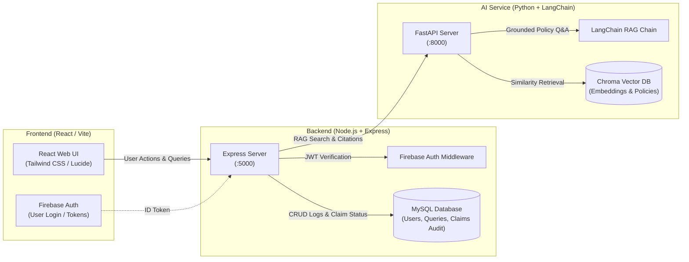

# Healthcare Insurance RAG Assistant

An AI-powered Retrieval-Augmented Generation (RAG) platform tailored for healthcare insurance claims analysts and policy teams.

---

## 🏛️ System Architecture



---

## 📁 Repository Structure

```text
healthcare-rag/
├── frontend/              # React (Vite / Tailwind / Axios / Firebase Client)
│   ├── public/
│   ├── src/
│   │   ├── components/    # Navbar, QueryCard, CitationBadge, DocumentChecklist
│   │   ├── pages/         # Dashboard, PolicySearch, ClaimsAudit, Login
│   │   ├── services/      # api.js, firebase.js
│   │   ├── App.jsx
│   │   └── main.jsx
│   ├── package.json
│   └── vite.config.js
├── backend/               # Node.js + Express (MySQL2 / Firebase Admin)
│   ├── config/            # db.js (MySQL pool), firebase.js
│   ├── controllers/       # ragController.js, claimController.js, authController.js
│   ├── routes/            # ragRoutes.js, claimRoutes.js
│   ├── middleware/        # authMiddleware.js, errorHandler.js
│   ├── services/          # aiClientService.js (HTTP client to AI microservice)
│   ├── package.json
│   └── server.js
├── ai-service/            # Python + LangChain + ChromaDB (FastAPI)
│   ├── data/
│   │   └── sample_policies/ # Ingested insurance policies & SOPs
│   ├── config.py          # Embedding & LLM configuration
│   ├── ingest.py          # Document loader, chunking & vector indexing
│   ├── rag.py             # Grounded retrieval chain & citation extractor
│   ├── main.py            # FastAPI endpoints (/query, /ingest, /health)
│   └── requirements.txt
└── README.md
```

---

## ⚡ Quick Start Instructions

### 1. AI Service (Python + LangChain)
```bash
cd ai-service
python -m venv venv
# On Windows:
.\venv\Scripts\activate
# On Linux/macOS:
# source venv/bin/activate

pip install -r requirements.txt
# Ingest sample policy documents
python ingest.py
# Start AI Microservice (running at http://localhost:8000)
uvicorn main:app --host 0.0.0.0 --port 8000 --reload
```

### 2. Backend (Node.js + Express + MySQL)
```bash
cd backend
npm install
# Set up .env with MySQL credentials & Firebase Admin config
npm run dev
# Running at http://localhost:5000
```

### 3. Frontend (React)
```bash
cd frontend
npm install
npm run dev
# Running at http://localhost:5173
```
